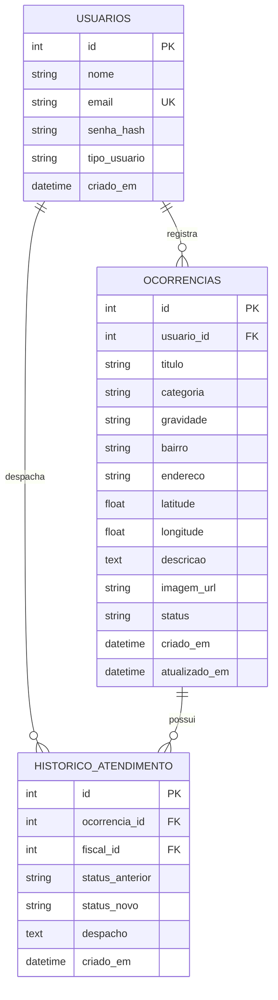

# EcoGuard — Especificação Inicial do Sistema (spec.md)

**Instituição:** Instituto Federal de Rondônia (IFRO) — Campus Porto Velho Calama  
**Curso:** Técnico em Desenvolvimento de Sistemas  
**Disciplina:** Programar com IA de forma responsável  
**Projeto:** EcoGuard — Sistema de Monitoramento e Registro de Ocorrências Ambientais  

---

## 1. Objetivo

O **EcoGuard** é uma plataforma web para registro, mapeamento e acompanhamento de ocorrências ambientais (como queimadas urbanas, descarte irregular de resíduos sólidos e poluição de mananciais) em Porto Velho - RO. O sistema permite que cidadãos denunciem crimes ambientais com localização geográfica e evidências, ao mesmo tempo em que oferece aos fiscais ambientais um painel centralizado para triagem, atualização de status e tomada de providências. Seu propósito é agilizar a fiscalização ambiental pública e fomentar a participação comunitária na preservação dos recursos naturais da Amazônia urbana.

---

## 2. Usuários

O sistema possui três tipos de usuários bem definidos, cada um com permissões específicas:

1. **Cidadão:**
   - Realizar autocadastro na plataforma informando dados pessoais (nome, e-mail e senha).
   - Efetuar login e logout com autenticação segura.
   - Registrar novas ocorrências ambientais contendo categoria, título, descrição, bairro, localização e foto/evidência.
   - Consultar e acompanhar o status de suas próprias denúncias (Pendente, Em Análise, Em Atendimento, Resolvido).
   - Visualizar o mapa público de calor e marcadores de denúncias ambientais no município.

2. **Fiscal Ambiental (Agente):**
   - Efetuar login com credencial de fiscal/operador público.
   - Visualizar todas as ocorrências cadastradas no município, com filtros por status, categoria, gravidade e bairro.
   - Atualizar o status das denúncias (ex.: transicionar de *Pendente* para *Em Análise*, *Em Atendimento* ou *Resolvido*).
   - Inserir pareceres técnicos, despachos e notas de atendimento no histórico de cada ocorrência.
   - Consultar indicadores estatísticos no dashboard de controle (total de denúncias, índices de resolução e distribuição por categoria).

3. **Administrador:**
   - Possui todas as permissões de Fiscal Ambiental.
   - Gerenciar contas de usuários e fiscais cadastrados.
   - Exportar relatórios analíticos das ocorrências ambientais registradas.

---

## 3. Casos de Uso Principais

A tabela abaixo descreve os casos de uso centrais do EcoGuard e seu mapeamento direto com os Requisitos Funcionais:

| Caso de Uso | Nome | Descrição Resumida | RF Correspondente |
|---|---|---|---|
| **UC01** | Cadastrar Usuário | O cidadão cria sua conta no sistema fornecendo nome, e-mail e senha. | RF01 |
| **UC02** | Autenticar Usuário | Usuários (cidadãos e fiscais) realizam login informando e-mail e senha. | RF02 |
| **UC03** | Registrar Ocorrência | O cidadão preenche e envia formulário de denúncia com categoria, descrição, endereço/bairro e foto. | RF03 |
| **UC04** | Consultar e Filtrar Ocorrências | Usuários visualizam a listagem e o mapa de ocorrências com filtros por status, categoria e bairro. | RF04, RF07 |
| **UC05** | Visualizar Detalhes e Histórico | O usuário consulta a ficha completa da denúncia e a linha do tempo de atendimento. | RF05 |
| **UC06** | Atualizar Status e Parecer Técnico | O fiscal ambiental altera o status da ocorrência e anexa notas de fiscalização. | RF06 |
| **UC07** | Acompanhar Métricas no Dashboard | O fiscal visualiza gráficos e indicadores consolidados de crimes ambientais. | RF07 |

---

## 4. Requisitos Funcionais (RF)

- **RF01 — Cadastro de Usuário:** O sistema deve permitir que novos usuários se cadastrem informando nome completo, e-mail único e senha com confirmação, atribuindo por padrão o perfil de Cidadão.
- **RF02 — Autenticação e Sessão:** O sistema deve autenticar o usuário validando e-mail e senha, mantendo a sessão ativa e restringindo o acesso a recursos protegidos conforme o tipo de usuário.
- **RF03 — Registro de Ocorrência Ambiental:** O sistema deve permitir que o cidadão autenticado registre uma ocorrência com os seguintes dados obrigatórios: título, categoria (*Queimada*, *Descarte Irregular de Resíduos*, *Poluição Hídrica / Igarapés*, *Desmatamento Urbano*, *Poluição Sonora / Ar*), gravidade (*Baixa*, *Média*, *Alta*, *Crítica*), bairro de Porto Velho, endereço/referência, descrição detalhada e anexo de foto/evidência. O status inicial da ocorrência é definido automaticamente como `Pendente`.
- **RF04 — Listagem e Filtragem de Ocorrências:** O sistema deve exibir a lista de ocorrências com paginação/rolagem e permitir filtros combinados por categoria, status, bairro e busca textual por palavras-chave no título.
- **RF05 — Detalhamento da Ocorrência:** O sistema deve exibir todos os dados da denúncia selecionada, incluindo data/hora de abertura, dados de localização, foto, e a linha do tempo cronológica com todos os despachos e alterações de status.
- **RF06 — Atualização de Status e Parecer:** O sistema deve permitir que usuários do perfil Fiscal Ambiental alterem o status da ocorrência (`Pendente`, `Em Análise`, `Em Atendimento`, `Resolvido`) e insiram uma justificativa ou parecer técnico, registrando data, hora e identificação do fiscal responsável.
- **RF07 — Painel de Indicadores e Mapa:** O sistema deve exibir um painel visual contendo o total geral de ocorrências, quantidade de casos pendentes vs. resolvidos, gráficos de distribuição por categoria e um mapa interativo com pinos das ocorrências georreferenciadas em Porto Velho.

---

## 5. Requisitos Não Funcionais (RNF)

- **RNF01 — Segurança no Armazenamento de Senhas (Obrigatório):** As senhas dos usuários nunca devem ser armazenadas em texto puro. O sistema deve aplicar algoritmo de hash unidirecional criptográfico com salting (PBKDF2/SHA-256 ou bcrypt) antes de gravar a credencial no banco de dados.
- **RNF02 — Validação no Servidor (Obrigatório):** Todo dado submetido por formulários deve ser rigorosamente validado no lado do servidor (backend) antes de qualquer persistência, rejeitando campos em branco, formatos inválidos de e-mail e payloads maliciosos, independentemente de validações existentes no cliente.
- **RNF03 — Desempenho e Tempo de Resposta:** As consultas de listagem e operações de gravação no banco de dados devem responder em um tempo médio inferior a 500 milissegundos em condições normais de tráfego.
- **RNF04 — Responsividade e Usabilidade:** A interface deve ser totalmente responsiva (design *mobile-first*), funcionando perfeitamente em telas de smartphones, tablets e desktops modernos, em navegadores baseados em Chromium, Firefox e Safari.
- **RNF05 — Integridade e Rastreabilidade:** O histórico de transições de status deve ser imutável; novas alterações de status devem sempre criar um novo registro histórico preservando o autor e a data de modificação.

---

## 6. Modelo de Dados (DER simples)

O sistema utiliza um banco de dados relacional com três tabelas essenciais conectadas por integridade referencial (chaves estrangeiras), satisfazendo plenamente todos os Requisitos Funcionais:

### Descrição das Tabelas e Relacionamentos:

1. **`usuarios`**: Armazena as credenciais e perfis dos usuários.
   - `id`: Chave primária (INTEGER AUTOINCREMENT).
   - `nome`: Nome completo do usuário (TEXT NOT NULL).
   - `email`: Endereço de e-mail único (TEXT NOT NULL UNIQUE).
   - `senha_hash`: Hash criptográfico seguro da senha (TEXT NOT NULL).
   - `tipo_usuario`: Perfil de acesso (`cidadao`, `fiscal`, `admin`).
   - `criado_em`: Data e hora do cadastro (DATETIME).

2. **`ocorrencias`**: Armazena as denúncias ambientais cadastradas.
   - `id`: Chave primária (INTEGER AUTOINCREMENT).
   - `usuario_id`: Chave estrangeira referenciando `usuarios(id)` (NOT NULL).
   - `titulo`: Título conciso da denúncia (TEXT NOT NULL).
   - `categoria`: Categoria ambiental (TEXT NOT NULL).
   - `gravidade`: Nível de urgência (`Baixa`, `Média`, `Alta`, `Crítica`).
   - `bairro`: Bairro de Porto Velho (TEXT NOT NULL).
   - `endereco`: Endereço ou ponto de referência (TEXT NOT NULL).
   - `latitude` / `longitude`: Coordenadas geográficas decimais.
   - `descricao`: Relato detalhado do fato ocorrido (TEXT NOT NULL).
   - `imagem_url`: Caminho ou link da foto da evidência (TEXT).
   - `status`: Status do atendimento (`Pendente`, `Em Análise`, `Em Atendimento`, `Resolvido`).
   - `criado_em` / `atualizado_em`: Timestamps de auditoria.

3. **`historico_atendimento`**: Armazena os despachos e atualizações de status.
   - `id`: Chave primária (INTEGER AUTOINCREMENT).
   - `ocorrencia_id`: Chave estrangeira referenciando `ocorrencias(id)` com integridade referencial (NOT NULL).
   - `fiscal_id`: Chave estrangeira referenciando `usuarios(id)` (NOT NULL).
   - `status_anterior`: Status antes da atualização (TEXT NOT NULL).
   - `status_novo`: Novo status atribuído (TEXT NOT NULL).
   - `despacho`: Parecer técnico ou providência adotada pelo fiscal (TEXT NOT NULL).
   - `criado_em`: Data e hora da atualização (DATETIME).

---

## 7. Critérios de Aceite

Os critérios abaixo foram redigidos no padrão BDD (*Given-When-Then* / *Dado que..., Quando..., Então...*) para os fluxos principais:

### Cenário 1: Cadastro de novo cidadão com sucesso (RF01, RNF01, RNF02)
- **Dado que** o cidadão está na tela de cadastro e não possui conta prévia com o e-mail informado,
- **Quando** ele preencher nome, e-mail válido, senha com pelo menos 6 caracteres e submeter o formulário,
- **Então** o servidor deve validar os dados, salvar a senha em formato de hash seguro no banco, persistir o usuário com perfil `cidadao` e retornar código de sucesso HTTP 201 com confirmação.

### Cenário 2: Tentativa de login com senha incorreta (RF02, RNF01)
- **Dado que** existe um usuário cadastrado com determinado e-mail,
- **Quando** o usuário tentar efetuar login informando uma senha incorreta,
- **Então** o servidor deve comparar o hash e recusar a autenticação com código HTTP 401 e exibir a mensagem amigável "E-mail ou senha inválidos", sem expor dados internos.

### Cenário 3: Registro de nova ocorrência ambiental válida (RF03, RNF02)
- **Dado que** um cidadão está autenticado no sistema,
- **Quando** ele preencher todos os campos obrigatórios (título, categoria, bairro, endereço, gravidade e descrição) e submeter o formulário,
- **Então** o backend deve validar todos os campos no servidor, gravar o registro na tabela `ocorrencias` com `status = 'Pendente'`, associar ao `usuario_id` da sessão e retornar os dados da ocorrência com código HTTP 201.

### Cenário 4: Validação no servidor com campos vazios (RF03, RNF02)
- **Dado que** um usuário tenta enviar uma ocorrência sem informar a descrição ou a categoria,
- **Quando** a requisição for recebida no servidor,
- **Então** o servidor deve interceptar o envio, rejeitar a gravação no banco, retornar código HTTP 400 e uma lista clara de quais campos são obrigatórios.

### Cenário 5: Atualização de status e registro de parecer por Fiscal (RF06, RNF05)
- **Dado que** um Fiscal Ambiental está autenticado e seleciona uma ocorrência no estado `Pendente`,
- **Quando** ele alterar o status para `Em Atendimento` e inserir o parecer técnico "Equipe de fiscalização deslocada ao local",
- **Então** o sistema deve atualizar o status na tabela `ocorrencias` para `Em Atendimento` e inserir um novo registro na tabela `historico_atendimento` com data/hora, status anterior, status novo e o ID do fiscal.

### Cenário 6: Filtragem de ocorrências por categoria e bairro (RF04)
- **Dado que** existem ocorrências cadastradas de diferentes bairros e categorias no banco,
- **Quando** o usuário filtrar por Categoria = "Queimada" e Bairro = "Calama",
- **Então** o sistema deve retornar exclusivamente as ocorrências que correspondam aos dois critérios informados.

---

## 8. Decisão de Stack e Deploy

### Justificativa da Stack Escolhida:

- **Backend e API REST:** **Node.js** com framework **Express**.
  - *Motivação:* Plataforma de alto desempenho, orientada a eventos assíncronos, com ecossistema rico e instalação nativa e ágil no ambiente Windows/Linux. O Express fornece roteamento REST limpo, middlewares de validação de formulários no servidor e controle de sessão.
- **Banco de Dados:** **SQLite** (relacional, compatível com ACID).
  - *Motivação:* Banco de dados relacional que implementa integralmente chaves estrangeiras, transações e tipos SQL sem exigir instalação de servidores pesados de terceiros na máquina de desenvolvimento. Permite portabilidade instantânea e migração direta para PostgreSQL em produção.
- **Criptografia e Segurança:** Módulo criptográfico com algoritmo PBKDF2 / SHA-512 e salting por usuário.
  - *Motivação:* Atende rigorosamente ao critério RNF01, eliminando completamente senhas em texto puro e garantindo proteção contra ataques de dicionário e tabelas rainbow.
- **Frontend:** **HTML5, CSS3 moderno (design system responsivo com tons ecológicos) e JavaScript Vanilla modular**, enriquecido com:
  - **Leaflet.js:** Biblioteca aberta de mapas geográficos interativos para renderização de ocorrências geolocalizadas em Porto Velho.
  - **Chart.js:** Visualização de dados dinâmicos do dashboard (gráficos de pizza e barras).
  - *Motivação:* Dispensa etapas complexas de compilação/bundling, carrega instantaneamente em qualquer dispositivo móvel e oferece performance máxima e facilidade de manutenção.

### Estratégia de Deploy:

- **Ambiente de Produção Recomendado:**
  - **Render / Railway / Fly.io:** Suporte nativo a projetos fullstack Node.js com SQLite persistente ou banco PostgreSQL gerenciado gratuito. O deploy é efetuado via repositório Git com comandos simples (`npm install && npm start`).
  - **Compatibilidade com Vercel:** O frontend pode ser publicado estaticamente na Vercel e consumir o backend via serverless functions ou API hospedada no Render, cumprindo integralmente a exigência de compatibilidade do enunciado.
- **Execução Local:**
  - Execução imediata via `npm start` ou `node src/server.js`, servindo a API REST e a interface web na porta `3000`.
