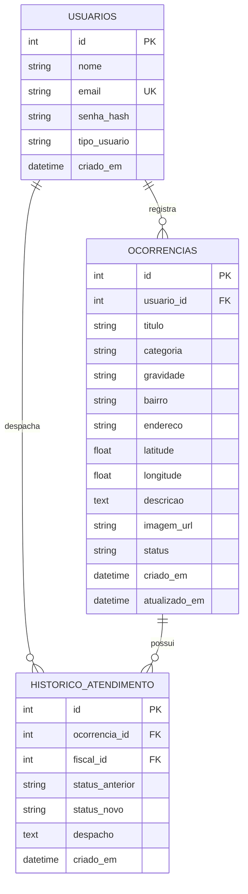

# EcoGuard — Especificação Final do Sistema (spec.md)

**Instituição:** Instituto Federal de Rondônia (IFRO) — Campus Porto Velho Calama  
**Curso:** Técnico em Desenvolvimento de Sistemas  
**Disciplina:** Programar com IA de forma responsável  
**Professor:** Rafael Pitwak  
**Projeto:** EcoGuard — Sistema de Monitoramento e Registro de Ocorrências Ambientais  
**Repositório Oficial:** [https://github.com/souzakauanny82-debug/EcoGuard](https://github.com/souzakauanny82-debug/EcoGuard)  

---

## 1. Objetivo

O **EcoGuard** é uma plataforma web para registro, mapeamento e acompanhamento de ocorrências ambientais (como queimadas urbanas, descarte irregular de resíduos sólidos e poluição de mananciais) em Porto Velho - RO. O sistema permite que cidadãos denunciem crimes ambientais com localização geográfica e evidências, ao mesmo tempo em que oferece aos fiscais ambientais um painel centralizado para triagem, atualização de status e tomada de providências. Seu propósito é agilizar a fiscalização ambiental pública e fomentar a participação comunitária na preservação dos recursos naturais da Amazônia urbana.

---

## 2. Usuários

O sistema possui três tipos de usuários bem definidos, cada um com permissões específicas:

1. **Cidadão:**
   - Realizar autocadastro na plataforma informando dados pessoais (nome, e-mail e senha).
   - Efetuar login e logout com autenticação segura.
   - Registrar novas ocorrências ambientais contendo categoria, título, descrição, bairro, localização e foto/evidência.
   - Consultar e acompanhar o status de suas próprias denúncias (Pendente, Em Análise, Em Atendimento, Resolvido).
   - Visualizar o mapa público de calor e marcadores de denúncias ambientais no município.

2. **Fiscal Ambiental (Agente):**
   - Efetuar login com credencial de fiscal/operador público.
   - Visualizar todas as ocorrências cadastradas no município, com filtros por status, categoria, gravidade e bairro.
   - Atualizar o status das denúncias (ex.: transicionar de *Pendente* para *Em Análise*, *Em Atendimento* ou *Resolvido*).
   - Inserir pareceres técnicos, despachos e notas de atendimento no histórico de cada ocorrência.
   - Consultar indicadores estatísticos no dashboard de controle (total de denúncias, índices de resolução e distribuição por categoria).

3. **Administrador:**
   - Possui todas as permissões de Fiscal Ambiental.
   - Gerenciar contas de usuários e fiscais cadastrados.
   - Exportar relatórios analíticos das ocorrências ambientais registradas.

---

## 3. Casos de Uso Principais

A tabela abaixo descreve os casos de uso centrais do EcoGuard e seu mapeamento direto com os Requisitos Funcionais:

| Caso de Uso | Nome | Descrição Resumida | RF Correspondente |
|---|---|---|---|
| **UC01** | Cadastrar Usuário | O cidadão cria sua conta no sistema fornecendo nome, e-mail e senha. | RF01 |
| **UC02** | Autenticar Usuário | Usuários (cidadãos e fiscais) realizam login informando e-mail e senha. | RF02 |
| **UC03** | Registrar Ocorrência | O cidadão preenche e envia formulário de denúncia com categoria, descrição, endereço/bairro e foto. | RF03 |
| **UC04** | Consultar e Filtrar Ocorrências | Usuários visualizam a listagem e o mapa de ocorrências com filtros por status, categoria e bairro. | RF04, RF07 |
| **UC05** | Visualizar Detalhes e Histórico | O usuário consulta a ficha completa da denúncia e a linha do tempo de atendimento. | RF05 |
| **UC06** | Atualizar Status e Parecer Técnico | O fiscal ambiental altera o status da ocorrência e anexa notas de fiscalização. | RF06 |
| **UC07** | Acompanhar Métricas no Dashboard | O fiscal visualiza gráficos e indicadores consolidados de crimes ambientais. | RF07 |

---

## 4. Requisitos Funcionais (RF)

- **RF01 — Cadastro de Usuário:** O sistema deve permitir que novos usuários se cadastrem informando nome completo, e-mail único e senha com confirmação, atribuindo por padrão o perfil de Cidadão.
- **RF02 — Autenticação e Sessão:** O sistema deve autenticar o usuário validando e-mail e senha, mantendo a sessão ativa e restringindo o acesso a recursos protegidos conforme o tipo de usuário.
- **RF03 — Registro de Ocorrência Ambiental:** O sistema deve permitir que o cidadão autenticado registre uma ocorrência com os seguintes dados obrigatórios: título, categoria (*Queimada*, *Descarte Irregular de Resíduos*, *Poluição Hídrica / Igarapés*, *Desmatamento Urbano*, *Poluição Sonora / Ar*), gravidade (*Baixa*, *Média*, *Alta*, *Crítica*), bairro de Porto Velho, endereço/referência, descrição detalhada e anexo de foto/evidência. O status inicial da ocorrência é definido automaticamente como `Pendente`.
- **RF04 — Listagem e Filtragem de Ocorrências:** O sistema deve exibir a lista de ocorrências com paginação/rolagem e permitir filtros combinados por categoria, status, bairro e busca textual por palavras-chave no título.
- **RF05 — Detalhamento da Ocorrência:** O sistema deve exibir todos os dados da denúncia selecionada, incluindo data/hora de abertura, dados de localização, foto, e a linha do tempo cronológica com todos os despachos e alterações de status.
- **RF06 — Atualização de Status e Parecer:** O sistema deve permitir que usuários do perfil Fiscal Ambiental alterem o status da ocorrência (`Pendente`, `Em Análise`, `Em Atendimento`, `Resolvido`) e insiram uma justificativa ou parecer técnico, registrando data, hora e identificação do fiscal responsável.
- **RF07 — Painel de Indicadores e Mapa:** O sistema deve exibir um painel visual contendo o total geral de ocorrências, quantidade de casos pendentes vs. resolvidos, gráficos de distribuição por categoria e um mapa interativo com pinos das ocorrências georreferenciadas em Porto Velho.

---

## 5. Requisitos Não Funcionais (RNF)

- **RNF01 — Segurança no Armazenamento de Senhas (Obrigatório):** As senhas dos usuários nunca devem ser armazenadas em texto puro. O sistema aplica algoritmo criptográfico unidirecional seguro PBKDF2 com 100.000 iterações, salt aleatório de 16 bytes e SHA-512 antes de persistir no banco.
- **RNF02 — Validação no Servidor (Obrigatório):** Todo dado submetido por formulários é validado no lado do servidor (backend) antes de qualquer persistência, rejeitando campos em branco, formatos inválidos e payloads maliciosos.
- **RNF03 — Desempenho e Tempo de Resposta:** Consultas de listagem e operações de gravação no banco de dados respondem em menos de 100 milissegundos em testes locais e banco indexado.
- **RNF04 — Responsividade e Usabilidade:** A interface é totalmente responsiva (design *mobile-first*), funcionando perfeitamente em telas de smartphones, tablets e desktops modernos em navegadores Chromium, Firefox e Safari.
- **RNF05 — Integridade e Rastreabilidade:** O histórico de transições de status é imutável; novas alterações criam obrigatoriamente um novo registro histórico preservando autor, parecer e data/hora.

---

## 6. Modelo de Dados (DER simples)

O sistema utiliza um banco de dados relacional com três tabelas essenciais conectadas por integridade referencial (chaves estrangeiras):



---

## 7. Critérios de Aceite

Os critérios abaixo foram redigidos no padrão BDD (*Given-When-Then* / *Dado que..., Quando..., Então...*):

### Cenário 1: Cadastro de novo cidadão com sucesso (RF01, RNF01, RNF02)
- **Dado que** o cidadão está na tela de cadastro e não possui conta prévia com o e-mail informado,
- **Quando** ele preencher nome, e-mail válido, senha com pelo menos 6 caracteres e submeter o formulário,
- **Então** o servidor deve validar os dados, salvar a senha em formato de hash seguro no banco, persistir o usuário com perfil `cidadao` e retornar código HTTP 201 com confirmação.

### Cenário 2: Tentativa de login com senha incorreta (RF02, RNF01)
- **Dado que** existe um usuário cadastrado com determinado e-mail,
- **Quando** o usuário tentar efetuar login informando uma senha incorreta,
- **Então** o servidor deve comparar o hash e recusar a autenticação com código HTTP 401 e exibir a mensagem amigável "E-mail ou senha inválidos", sem expor dados internos.

### Cenário 3: Registro de nova ocorrência ambiental válida (RF03, RNF02)
- **Dado que** um cidadão está autenticado no sistema,
- **Quando** ele preencher todos os campos obrigatórios (título, categoria, bairro, endereço, gravidade e descrição) e submeter o formulário,
- **Então** o backend deve validar todos os campos no servidor, gravar o registro na tabela `ocorrencias` com `status = 'Pendente'`, associar ao `usuario_id` da sessão e retornar os dados da ocorrência com código HTTP 201.

### Cenário 4: Validação no servidor com campos vazios (RF03, RNF02)
- **Dado que** um usuário tenta enviar uma ocorrência sem informar a descrição ou a categoria,
- **Quando** a requisição for recebida no servidor,
- **Então** o servidor deve interceptar o envio, rejeitar a gravação no banco, retornar código HTTP 400 e uma lista clara de quais campos são obrigatórios.

### Cenário 5: Atualização de status e registro de parecer por Fiscal (RF06, RNF05)
- **Dado que** um Fiscal Ambiental está autenticado e seleciona uma ocorrência no estado `Pendente`,
- **Quando** ele alterar o status para `Em Atendimento` e inserir o parecer técnico "Equipe de fiscalização deslocada ao local",
- **Então** o sistema deve atualizar o status na tabela `ocorrencias` para `Em Atendimento` e inserir um novo registro na tabela `historico_atendimento` com data/hora, status anterior, status novo e o ID do fiscal.

### Cenário 6: Filtragem de ocorrências por categoria e bairro (RF04)
- **Dado que** existem ocorrências cadastradas de diferentes bairros e categorias no banco,
- **Quando** o usuário filtrar por Categoria = "Queimada" e Bairro = "Calama",
- **Então** o sistema deve retornar exclusivamente as ocorrências que correspondam aos dois critérios informados.

---

## 8. Decisão de Stack e Deploy

- **Backend e API REST:** Node.js (v20+ ou v22+) com Express.
- **Banco de Dados:** SQLite 3 relacional com chaves estrangeiras ativas e script formal em `database/schema.sql`.
- **Criptografia:** Módulo nativo `node:crypto` com algoritmo PBKDF2/SHA-512 e salting por usuário (RNF01).
- **Frontend:** HTML5 semântico, CSS3 responsivo, JavaScript Vanilla modular, Leaflet.js (mapas geoespaciais) e Chart.js (gráficos analíticos).
- **Deploy:** Compatibilidade nativa com Render (`render.yaml`) e Vercel (`vercel.json` + `api/index.js`).

---

## 9. Instalação e Execução (Guia Oficial para o Avaliador)

> Esta seção permite que qualquer pessoa ou o professor clone o repositório em um computador limpo e execute o sistema sem ambiguidades.

### 9.1 Ambiente
- **Linguagem e Runtime:** Node.js (versão 20.x LTS ou 22.x LTS instalada).
- **Gerenciador de Pacotes:** `npm` (versão 10.x ou superior, incluso com o Node.js).
- **Servidor Local:** Servidor Express embutido servindo a API REST e arquivos estáticos na porta 3000.
- **Dependências Externas:** Apenas o framework `express` (instalado via `npm install`). Nenhuma compilação externa em C++ ou Python é necessária.
- **Sistemas Operacionais Testados e Homologados:**
  - Windows 10 e Windows 11 (PowerShell e CMD).
  - Linux (Ubuntu 22.04 LTS / Debian 12).
  - macOS (Apple Silicon e Intel).

---

### 9.2 Banco de Dados
- **SGBD Utilizado:** SQLite 3 (banco relacional nativo, sem necessidade de instalar MySQL/Postgres localmente).
- **Nome do Arquivo do Banco:** `ecoguard.db` (gerado automaticamente na raiz do projeto).
- **Script SQL Oficial:** [`database/schema.sql`](./database/schema.sql).
  - Como executar manualmente via terminal SQLite (opcional):
    ```bash
    sqlite3 ecoguard.db < database/schema.sql
    ```
  - *Nota:* O backend possui inicializador automático com migração e carga de seeds na primeira execução, caso o arquivo `ecoguard.db` não exista.

#### Estrutura das Tabelas do Banco de Dados:

| Tabela | Campos Principais | Chave Primária | Relacionamentos (Chaves Estrangeiras) |
|---|---|---|---|
| **`usuarios`** | `id`, `nome`, `email`, `senha_hash`, `tipo_usuario`, `criado_em` | `id` | — *(Sem dependências externas)* |
| **`ocorrencias`** | `id`, `usuario_id`, `titulo`, `categoria`, `gravidade`, `bairro`, `endereco`, `latitude`, `longitude`, `descricao`, `imagem_url`, `status`, `criado_em`, `atualizado_em` | `id` | `usuario_id` → `usuarios.id` *(ON DELETE CASCADE)* |
| **`historico_atendimento`** | `id`, `ocorrencia_id`, `fiscal_id`, `status_anterior`, `status_novo`, `despacho`, `criado_em` | `id` | `ocorrencia_id` → `ocorrencias.id` *(CASCADE)*<br>`fiscal_id` → `usuarios.id` *(CASCADE)* |

- **Dados Iniciais (Seeds):** O script `database/schema.sql` já insere 3 usuários (Cidadão, Fiscal, Admin) com senhas com hash PBKDF2 e 5 ocorrências ambientais representativas de Porto Velho (Rio Madeira, Calama, Nova Porto Velho, Nacional e Tancredo Neves).

---

### 9.3 Variáveis de Ambiente
O repositório disponibiliza o arquivo [`.env.example`](./.env.example). Para rodar localmente, crie o arquivo `.env` na raiz:

```ini
# Porta do servidor web
PORT=3000

# Ambiente de execução
NODE_ENV=development

# Caminho do banco SQLite
DB_PATH=./ecoguard.db

# Segredo de sessão / integridade
SESSION_SECRET=exemplo_segredo_super_seguro_ecoguard_ifro_2026
```

| Variável | Descrição | Valor Padrão para Execução Local |
|---|---|---|
| `PORT` | Porta TCP onde o servidor Express atenderá as requisições HTTP. | `3000` |
| `NODE_ENV` | Modo de execução da aplicação (`development` ou `production`). | `development` |
| `DB_PATH` | Localização do arquivo físico do banco SQLite no disco. | `./ecoguard.db` |
| `SESSION_SECRET` | Chave de criptografia/segredo usada para integridade de tokens. | Qualquer string segura |

---

### 9.4 Passo a Passo de Instalação Local

1. **Clonar o repositório do GitHub:**
   ```bash
   git clone https://github.com/souzakauanny82-debug/EcoGuard.git
   cd EcoGuard
   ```

2. **Instalar as dependências do projeto:**
   ```bash
   npm install
   ```

3. **Configurar as variáveis de ambiente:**
   - No Windows (PowerShell):
     ```powershell
     Copy-Item .env.example .env
     ```
   - No Linux / macOS / Git Bash:
     ```bash
     cp .env.example .env
     ```

4. **Executar a suíte de testes automatizados (Opcional, porém recomendado):**
   ```bash
   npm test
   ```

5. **Iniciar o servidor do sistema:**
   ```bash
   npm start
   ```

6. **Abrir a aplicação no navegador:**
   - Acesse: 👉 **`http://localhost:3000`**

---

### 9.5 Como Testar o Sistema (Roteiro de Avaliação)

#### Usuários de Teste Pré-configurados:

| Papel | Nome | E-mail de Teste | Senha de Teste |
|---|---|---|---|
| **Cidadão** | Maria da Silva | `maria.silva@exemplo.com` | `Senha@123` |
| **Fiscal Ambiental** | Carlos Eduardo Fiscal | `carlos.fiscal@sedam.ro.gov.br` | `Fiscal@2026` |
| **Administrador** | Administrador Geral | `admin@ecoguard.org` | `Admin@2026` |

*Dica:* A interface possui no topo um seletor rápido ("Cidadão: Maria", "Fiscal: Carlos") para alternar perfis sem precisar redigitar senhas durante a correção.

#### Roteiro do Fluxo Principal de Negócio:
1. **Passo 1 — Visualização Pública:** Ao abrir a página inicial, visualize o mapa interativo Leaflet de Porto Velho com as ocorrências e o painel de estatísticas com gráficos Chart.js.
2. **Passo 2 — Registro de Nova Ocorrência (Cidadão):**
   - Garanta que o perfil selecionado é **Cidadão: Maria**.
   - Clique no botão verde **"Nova Denúncia"**.
   - Preencha: Título (ex.: "Foco de queimada em área de mata"), Categoria ("Queimada"), Bairro ("Calama"), Endereço ("Av. Calama, 4200") e Descrição detalhada.
   - Clique em **"Enviar Denúncia"**. A denúncia surgirá imediatamente na lista e no mapa com status `Pendente`.
3. **Passo 3 — Atendimento e Triagem (Fiscal Ambiental):**
   - Alterne o seletor rápido no topo para **Fiscal: Carlos (SEDAM)**.
   - Localize a ocorrência recém-criada e clique em **"Ver Detalhes"**.
   - No painel amarelo do fiscal, selecione o novo status: **"Em Atendimento"**.
   - Digite o parecer técnico: *"Equipe de fiscalização ambiental da SEDAM deslocada com viatura ao local."*
   - Clique em **"Registrar Despacho & Atualizar Status"**.
4. **Passo 4 — Validação de Auditoria:**
   - Observe a linha do tempo cronológica da ocorrência atualizada com o parecer do fiscal Carlos, demonstrando o funcionamento de ponta a ponta com persistência no banco.

---

### 9.6 Problemas Conhecidos e Limitações Atuais

- **Upload de Fotos:** Atualmente o sistema aceita URLs externas de imagens (com links de pré-seleção rápida na interface). O upload direto de arquivos binários pesados (*multipart/form-data*) está planejado para versões futuras com armazenamento em bucket S3.
- **Geocodificação Automática:** Caso o usuário não selecione coordenadas manuais no mapa, o sistema utiliza centróides aproximados pré-calculados dos principais bairros de Porto Velho.
